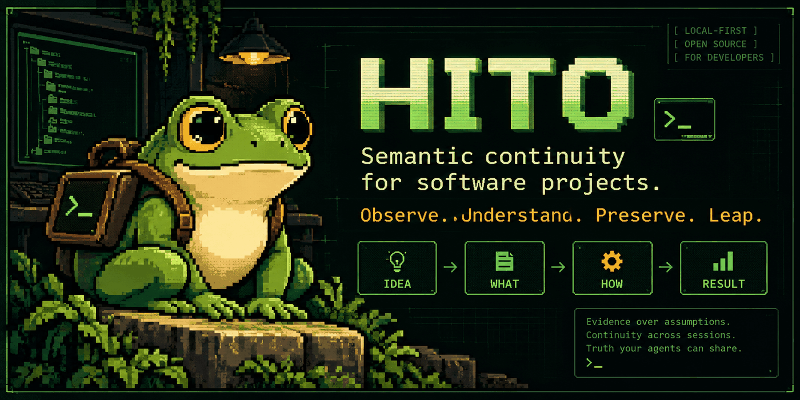

<p align="center">
  
</p>

<p align="center">
  <a href="https://github.com/CodeDeityX/HITO/releases"></a>
  <a href="LICENSE"></a>
  <a href="https://github.com/CodeDeityX/HITO/stargazers"></a>
  <a href="https://github.com/CodeDeityX/HITO/issues"></a>
  <a href="CONTRIBUTING.md"></a>
</p>

<p align="center">
  <a href="#quick-start">Quick start</a> ·
  <a href="#see-the-boundary">How it works</a> ·
  <a href="#contribute">Contribute</a> ·
  <a href="docs/LIMITATIONS.md">Limitations</a> ·
  <a href="docs/COMMUNITY.md">Community</a>
</p>

# HITO

**Semantic continuity for software projects.**

Software projects outlive conversations, coding agents, IDE sessions, and individual implementations. HITO is a **local-first Semantic Continuity System** for maintaining a bounded, evidence-aware view of **what the project means** as those things change.

> **The project owns its truth. The agent consumes a projection of that truth.**

**Observe. Understand. Preserve. Leap.**

## Why HITO?

Git tells you which files changed. Code graphs help explain what is connected. HITO asks a different set of questions:

| Question | HITO's approach |
| :-- | :-- |
| What do we know? | Established claims must retain their supporting evidence. |
| What remains uncertain? | `UNKNOWN`, `PARTIAL`, and `INDETERMINATE` are preserved, not guessed away. |
| What does this project intend? | Intent is distinguished from implementation and documentation claims. |
| What must not be touched? | Protected scope and constraints stay visible. |
| What should happen next? | A next action is not treated as justified without sufficient authority. |
| Can another agent continue? | CLI, VS Code, and agent context consume projections of shared semantic identity. |

## The HITO model

```text
                  A PROJECT'S CANONICAL TRUTH
                             |
                  Evidence / Continuity /
                     Contradiction rails
                             |
                    Bounded projections
                      /      |       \
                    CLI   VS Code   Agent

         IDEA  ->  WHAT  ->  HOW  ->  RESULT

              NEVER LET HOW DEFINE WHAT
```

The four coordinates distinguish **why a project exists**, **what it intends to become**, **how the implementation attempts that**, and **what is actually demonstrated**.

### Three rails, one shared reference

| Evidence | Continuity | Contradiction |
| :-- | :-- | :-- |
| Distinguish claims from verified results | Carry meaning across sessions and agents | Keep disagreements and uncertainty visible |

HITO is **not** a universal code-graph engine and does **not** claim exhaustive structural comprehension of arbitrary repositories. Structural acquisition is bounded in this release candidate. See [Limitations](docs/LIMITATIONS.md).

## Quick start

**Current qualification: Windows-first.** Node.js 22+ recommended; VS Code 1.90+ for the extension. Use a **disposable or controlled test project** for your first initialization.

```powershell
# Clone HITO and install its locked tooling dependencies.
git clone https://github.com/CodeDeityX/HITO.git
cd HITO
npm ci --ignore-scripts

# Read a project's bounded status without executing its application code.
node .\core\bin\hito.cjs status --root "C:\Projects\example"

# Optional: initialize and admit a project you control.
node .\core\bin\hito.cjs init --root "C:\Projects\example"
node .\core\bin\hito.cjs intake --canonical --root "C:\Projects\example"

# Query continuity and justified next steps.
node .\core\bin\hito.cjs next --root "C:\Projects\example"
node .\core\bin\hito.cjs why --root "C:\Projects\example"
node .\core\bin\hito.cjs mri --root "C:\Projects\example"
```

HITO currently persists canonical project state in **`.maat/`**. That is intentional: changing the namespace is a governed migration, not a branding exercise. See the [full Quick Start](docs/QUICKSTART.md).

### VS Code extension

Build the release-candidate VSIX from source:

```powershell
npm run package:vsix
```

Install the generated `dist-release/hito-0.1.0-rc.1.vsix` using **VS Code → Extensions → … → Install from VSIX**. Open a project and select the **HITO Frog** in the Activity Bar.

The extension provides **Guided Project, Engineer Detail, Forensic Detail, Project Overview, and Agent Context**. All remain projections of the same bounded truth; the interface does not grant execution authority.

## See the boundary

HITO can show a **partial semantic observation** while leaving project health undetermined, HOW unknown, and the next safe action unavailable. That is the intended behavior, not a missing promise: evidence must come before certainty.

For the limits of `v0.1.0-rc.1`, read [What HITO does *not* claim](docs/LIMITATIONS.md) and [Architecture](docs/ARCHITECTURE.md).

## Contribute

**The project is public because its limitations should be testable by people who did not build it.** New contributors do not need prior knowledge of HITO.

We particularly welcome reproducible examples of semantic continuity loss, incorrect certainty, missing structural evidence, inaccessible onboarding, cross-platform failures, UI issues, documentation improvements, and thoughtful RFCs for pluggable structural providers.

**[Start contributing](CONTRIBUTING.md)** · **[Community guide](docs/COMMUNITY.md)** · **[Report a bug](https://github.com/CodeDeityX/HITO/issues/new/choose)** · **[Propose an improvement](https://github.com/CodeDeityX/HITO/issues)**

> If the onboarding assumes knowledge you don't have, **that itself is a bug**.

## Documentation

[Quick Start](docs/QUICKSTART.md) · [Architecture](docs/ARCHITECTURE.md) · [Limitations](docs/LIMITATIONS.md) · [Roadmap](ROADMAP.md) · [Research](docs/RESEARCH.md) · [Security](SECURITY.md) · [Governance](GOVERNANCE.md) · [Brand](docs/BRAND.md)

## License and credit

HITO is open source under [Apache License 2.0](LICENSE). **Founder / Original Author: [CodeDeityX](https://github.com/CodeDeityX).**

The HITO Frog is the project mascot. © 2026 CodeDeityX.
